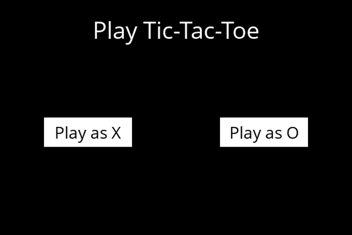

# Tic-Tac-Toe AI

A Tic-Tac-Toe game where you play against a computer that uses the minimax algorithm to choose its moves. You pick X or O in a pygame window, and the AI searches the game tree to play the other side. This is the Tic-Tac-Toe project from Harvard's CS50 Introduction to Artificial Intelligence with Python.



The demo is a recording of the real game running. The clicks were simulated by a script, and the cursor was drawn on afterwards to show where each click lands.

Video walkthrough: https://youtu.be/eSrJq8CEIwU

## Features

- Choose to play as X (who moves first) or O.
- Click a square to make your move. The title shows whose turn it is and "Computer thinking..." while the AI picks its move.
- The game announces the winner or a tie, and "Play Again" returns to the start screen.

## How it works

The game logic is in `tictactoe.py`. The board is a 3×3 list where each square is `"X"`, `"O"` or `None`.

### Game rules as functions

- `player(board)`: X moves first, so it is X's turn when both players have the same number of marks, and O's turn otherwise.
- `actions(board)`: the set of empty squares, as `(row, column)` pairs.
- `result(board, action)`: a deep copy of the board with the current player's mark added. It raises an exception if the square is taken, and never changes the original board.
- `winner(board)`: checks the rows, the columns (by transposing the board with NumPy) and both diagonals for three in a row.
- `terminal(board)`: the game is over when someone has won or no empty squares are left.
- `utility(board)`: the score of a finished game: 1 if X won, -1 if O won, 0 for a tie.

### Minimax

Minimax assumes both players play their best. X tries to make the score as high as possible and O tries to make it as low as possible.

- `max_value(board)` returns the best score X can force from a position: the highest of the `min_value` scores of every possible next board.
- `min_value(board)` returns the best score O can force: the lowest of the `max_value` scores of every possible next board.
- Both stop at a finished game and return its `utility`.
- `minimax(board)` tries every available move for the current player and returns the move with the best resulting score: the highest for X, the lowest for O.

Because the search looks ahead all the way to the end of the game, the AI never loses (see the known limitation below for how this was checked).

### Pruning

To search less of the game tree, the functions pass alpha and beta bounds down the tree and stop looking at a position's remaining moves once its score goes past a bound (alpha-beta pruning).

## What I implemented

The course provides `runner.py` (the pygame interface) and the function outlines in `tictactoe.py`. I implemented the game logic and the AI: `player`, `actions`, `result`, `winner`, `terminal`, `utility` and `minimax`, plus the `max_value` and `min_value` helpers with pruning.

## Known limitation

The pruning checks in `max_value` and `min_value` are not the standard alpha-beta conditions, and the bounds are not updated inside those functions. As a result, in some positions the AI chooses a move that still guarantees at least a draw when a win was available. I tested every position reachable in a game: the AI chose the best move in 4,421 of 4,520 positions, and across all 924 possible games against every sequence of human moves (with the AI as X or O) it never lost.

## Project structure

```
runner.py              The pygame window: start screen, board, clicks and messages
tictactoe.py           Game rules and the minimax AI
OpenSans-Regular.ttf   Font used by the interface
game.png               Screenshot of the game
requirements.txt       Package list (see the note below)
```

## Running it locally

Tested with Python 3.12 and pygame 2.6.1.

```bash
git clone https://github.com/sangyetenphel/ai50-tic-tac-toe.git
cd ai50-tic-tac-toe
python3 -m venv venv
source venv/bin/activate
pip install pygame numpy
python runner.py
```

Run `runner.py` from inside the project folder, because it loads the font file by its relative path.

`requirements.txt` also lists `copy`, which is part of Python's standard library rather than a package on PyPI, so `pip install -r requirements.txt` fails. Installing `pygame` and `numpy` directly, as above, is all that's needed.

## Built with

- Python 3
- [pygame](https://www.pygame.org/) for the game window
- NumPy (used to check the columns for a winner)

## Credits

This is a project from [CS50's Introduction to Artificial Intelligence with Python](https://cs50.harvard.edu/ai/) by Harvard University. The project specification and `runner.py` come from the course.

Created by Sangye Tenphel, 2020.
